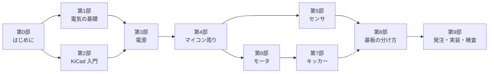
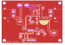

# RCJ サッカーの電子回路設計

ロボカップジュニア サッカー（インフラレッド）のロボットの電子回路を、**KiCad で回路図を描き、基板を設計し、発注して、組み立てて検査する**ところまで、自分でできるようになるための教材です。

- **読む人**

    RCJ に出る中学生・高校生。大学生向けの話は「もっと深く」に分けてあります。

- **進め方**

    理論 3：手を動かす 7。各章に KiCad の操作、計算、実機の作業があります。

- **できあがるもの**

    教材用ロボットの基板 4 枚（電源・メイン・IR リング・モータ）とキッカー基板。すべて KiCad のデータつきです。

- **費用**

    KiCad と GitHub は無料。お金がかかるのは基板の発注と部品だけです。

## 全体の流れ

## 教材用ロボットの基板

| 基板 | 中身 | KiCad データ |
|---|---|---|
| H1 LED 基板 | KiCad の練習用（電池・スイッチ・LED） | [`kicad/h1-led`](https://github.com/Asg1223/rcj-circuit/tree/main/kicad/h1-led) |
| 電源基板 | 3S リポ → 逆接続保護 → 5 V・3.3 V | [`kicad/power`](https://github.com/Asg1223/rcj-circuit/tree/main/kicad/power) |
| メイン基板 | Arduino Nano 形のマイコン、コネクタ、レベル変換 | [`kicad/main`](https://github.com/Asg1223/rcj-circuit/tree/main/kicad/main) |
| IR リング基板 | IR 受光モジュール 8 個 + 74HC165 | [`kicad/ir-ring`](https://github.com/Asg1223/rcj-circuit/tree/main/kicad/ir-ring) |
| モータドライバ基板 | DRV8871 × 4 | [`kicad/motor`](https://github.com/Asg1223/rcj-circuit/tree/main/kicad/motor) |
| キッカー基板 | 昇圧モジュール・コンデンサ・放電スイッチ（48 V 以下） | [`kicad/kicker`](https://github.com/Asg1223/rcj-circuit/tree/main/kicad/kicker) |

{ .board width="520" }

!!! note "教材の基板は架空の構成です"
    ここにある回路はすべて教材用に作った**架空の構成**です。部品の値は動く範囲で選んでいますが、実際に作る前に、使う部品のデータシートで必ず確かめてください。自分のチームの基板は、公開しない**チーム用リポジトリ**に置きます（[付録：チーム用リポジトリ](appendix/team-repo.md)）。

## このサイトの KiCad データについて

- KiCad 10 で開けます。ファイルは少し古い形式（KiCad 7 形式）で保存してあるので、開いて保存すると KiCad 10 の形式に変わります。
- GitHub に push すると、GitHub Actions が KiCad 10 で **ERC（回路図のチェック）と DRC（基板のチェック）** を走らせ、ガーバー（製造データ）を作ります。リポジトリの「Actions」タブから受け取れます。

## 関連する教材

- [RCJ サッカーで機械学習](https://asg1223.github.io/rcj-soccer-ml/)：IR センサの値からボールの位置を推定するモデルを作り、マイコンで動かす教材です。この教材の IR リング基板やメイン基板とつながります。

## ライセンス

本文もコードも KiCad データも MIT ライセンスです。
