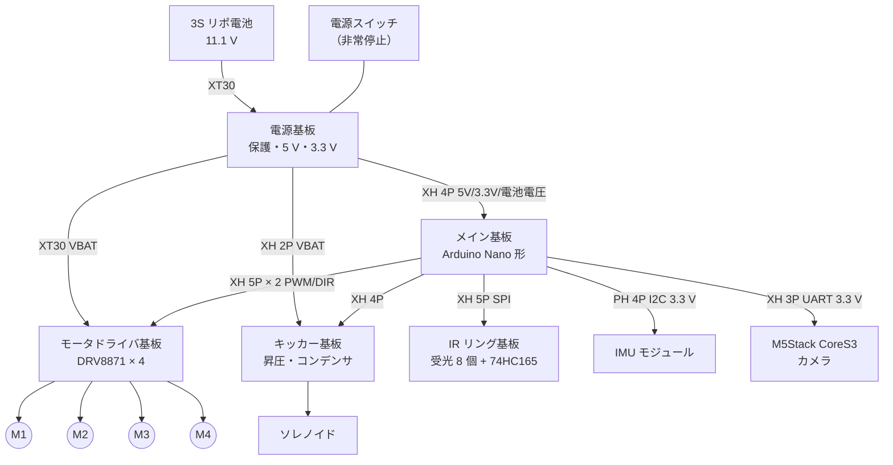

# 0-1 教材用ロボットの全体像

## ねらい

- 教材で作るロボットの基板が、どうつながっているかを説明できる
- 「基板を分ける」理由を一つ言える

## 4 枚＋1 枚の基板

教材では、サッカーロボットの電子回路を次のように分けます。

| 基板 | 役割 | 大きさ |
|---|---|---|
| 電源基板 | 電池から各基板へ電気を配る。逆接続・ショートから守る | 70 × 50 mm |
| メイン基板 | マイコンを載せ、ほかの基板とつなぐ | 102 × 60 mm |
| IR リング基板 | ボールの赤外線を 8 方向で受ける | 直径 90 mm |
| モータドライバ基板 | 4 個のモータを動かす | 102 × 46 mm |
| キッカー基板 | 電圧を上げてコンデンサにため、ソレノイドで一気に放す | 64 × 52 mm |

## なぜ基板を分けるのか

1 枚にまとめると配線は減りますが、教材では分けています。理由は次のとおりです。

- **壊れたところだけ取りかえられる**：モータドライバは一番こわれやすい部分です。
- **ノイズを分けられる**：大電流が流れるモータ・キッカーと、小さな信号のセンサを離せます。
- **少しずつ作れる**：まず電源基板、次にメイン基板、と順に作って確かめられます。
- **ロボットの形に合わせやすい**：IR リングは円形、モータドライバは車輪の近く、と置き場所を変えられます。

くわしくは [8-1 1 枚にするか分けるか](../part8-system/8-1-split.md) で考えます。

## 機械学習の教材とのつながり

[RCJ サッカーで機械学習](https://asg1223.github.io/rcj-soccer-ml/) では、IR センサの値をマイコンで読み、CoreS3 でカメラの推論をします。この教材のメイン基板には、

- IR リング基板を読むための SPI のコネクタ
- CoreS3 とつなぐ UART のコネクタ（3.3 V に変換ずみ）

がついているので、そのまま組み合わせられます。

## チェック問題

1. モータドライバ基板に電気を送っているのはどの基板ですか。
2. 基板を分けるよい点を 2 つ挙げてください。

??? success "答え"
    1. 電源基板（XT30 コネクタで VBAT を送る）
    2. 壊れたところだけ取りかえられる、ノイズを分けられる、少しずつ作って確かめられる、ロボットの形に合わせやすい（このうち 2 つ）

??? example "もっと深く：大学生向け"
    実際の強豪チームには、メイン基板にマイコンを直接実装して 4 層基板にするチームも、サブマイコンを何個も使うチームもあります。どちらが正しいということはなく、**修理のしやすさ・重さ・設計の手間**のバランスで決めます。この教材は「中高生が自分で直せる」ことを優先して、マイコンボードを載せる形にしています。
