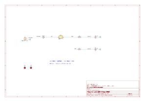

# 2-2 回路図を描く

## ねらい

- 部品を置き、線・ラベル・電源記号でつなげる
- ERC（電気的ルールチェック）のエラーを読んで直せる

## 回路図の基本

### つなぎ方は 3 つ

| つなぎ方 | キー | 使いどころ |
|---|---|---|
| 線（ワイヤ） | ++w++ | 近くの部品どうし |
| ラベル | ++l++ | 遠くの部品どうし。同じ名前のラベルはつながる |
| 電源記号 | ++p++ | GND、+5V、+3V3 など。同じ記号はつながる |

教材の回路図は、ほとんどを**ラベル**でつないでいます。線がごちゃごちゃにならず、「この線は何の信号か」が名前でわかるからです。

!!! tip "ネット名は意味のある名前に"
    `M1_PWM`、`VBAT_SENSE` のように、何の信号かわかる名前をつけます。基板の配線でもこの名前が出てくるので、配線のまちがいに気づきやすくなります。

### 未接続フラグ

使わないピンには ++q++ で **×（未接続フラグ）** を付けます。付けないと、ERC が「つなぎ忘れでは？」と警告します。

### PWR_FLAG

ERC は「電源入力ピン（power input）が、電源出力ピン（power output）から電気をもらっているか」を調べます。電池やコネクタから入ってくる電源は、KiCad からは「どこから来ているかわからない」ので、**PWR_FLAG** を付けて「ここが電源です」と教えます。

教材の IR リング基板では、受光モジュールの電源（VS0〜VS7）が 100 Ω の抵抗を通っているので、それぞれに PWR_FLAG を付けています。

## 手を動かす：H1 の回路図を描く

`my-led`（[2-1](2-1-project.md) で作ったもの）の回路図を開き、次の回路を描きます。完成形は `kicad/h1-led/h1-led.kicad_sch` です。

{ .schem }

1. ++a++ で部品を置きます。
    - `Connector_Generic:Conn_01x02`（J1：電池）
    - `Device:D_Schottky`（D1：逆接続保護）
    - `Switch:SW_DIP_x01`（SW1）
    - `Device:R` × 2（R1 470 Ω、R2 1 kΩ）
    - `Device:LED` × 2（D2 赤、D3 緑）
2. ++r++ で回転、++x++ で左右反転して、左から右へ電気が流れるように並べます。
3. ++w++ で線を引くか、++l++ でラベルを付けてつなぎます。
4. ++p++ で `GND` を置きます。
5. J1 の 1 番（電池の＋）と GND に `PWR_FLAG` を付けます。
6. 部品をダブルクリックして値（`470` など）を入れます。
7. 「ツール → 回路図をアノテーション」で R1、R2…の番号を付けます。

## ERC を走らせる

「検査 → 電気的ルールチェッカー」で「ERC を実行」を押します。

| よく出るエラー | 意味 | 直し方 |
|---|---|---|
| Pin not connected | ピンがどこにもつながっていない | つなぐか、×（未接続フラグ）を付ける |
| Input Power pin not driven by any Output Power pins | 電源ピンに電気が来ていない | 電源の入り口に PWR_FLAG |
| Pin connected to other pins, but not driven | 入力ピンだけで、出力がない | 本当にそれでよいか確かめる |
| Label is not connected | ラベルがピンや線の端に乗っていない | ラベルの位置を線の端に合わせる |

!!! note "GitHub Actions の ERC"
    このリポジトリでは、push すると KiCad 10 の ERC が自動で走ります。**エラー**があると Actions が赤（失敗）になります。警告は表示だけです。結果は Actions の「Artifacts」の `*-erc.json` で見られます。

## チェック問題

1. 同じ名前のラベルが離れたところにあります。つながっていますか。
2. マイコンの使わないピンに何もしないと、ERC は何と言いますか。

??? success "答え"
    1. つながっています（同じシートの中なら）。
    2. 「Pin not connected」のエラー。使わないなら × を付けます。
