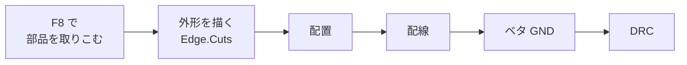

# 2-4 基板レイアウト

## ねらい

- 回路図から基板に部品を取りこみ、配置・配線・ベタ GND まで進められる
- 電流に合わせて配線の太さを決められる

## 手順の全体

## 1. 部品を取りこむ

基板エディタを開き、++f8++（「ツール → 回路図から基板を更新」）を押します。部品がかたまって出てくるので、クリックして置きます。部品のピンの間には、つなぐ先を示す細い線（**ラッツネスト**）が出ます。

## 2. 外形を描く

1. レイヤーを `Edge.Cuts` にします。
2. 「長方形」ツールで外形を描きます（H1 は 45 × 25 mm）。角を丸くすると、手にささりにくく、見た目もよくなります。
3. 取りつけ穴（M3 なら直径 3.2 mm）の位置を、ロボットの機構と合わせて決めます。

## 3. 配置

配置で基板の出来の 8 割が決まります。

| 順番 | 置くもの | 理由 |
|---|---|---|
| 1 | コネクタ、スイッチ、取りつけ穴、LED | ロボットの形で位置が決まっているもの |
| 2 | 大電流の部品（MOSFET、ドライバ、コンデンサ） | 太い配線を短くしたい |
| 3 | IC と、そのパスコン | パスコンは IC の電源ピンのすぐ横 |
| 4 | 残りの抵抗・コンデンサ | つながる相手の近く |

!!! tip "ラッツネストがからまない向きにする"
    ラッツネストの線がたくさん交差しているなら、部品を回転（++r++）したり入れかえたりして、交差を減らしてから配線します。配線が楽になります。

## 4. 配線

++x++ で配線します。配線中に ++v++ を押すとビアが打たれ、裏面（B.Cu）に移ります。

### 太さの決め方

電流が多いほど、配線を太くします。IPC-2221 という規格の式で、温度上昇から幅を計算できます（[計算ツール](../tools/index.md#trace)）。

| 電流 | 外層・銅 35 µm・温度上昇 10 ℃ の目安 |
|---|---|
| 0.5 A | 0.12 mm |
| 1 A | 0.3 mm |
| 2 A | 0.8 mm |
| 3 A | 1.3 mm |
| 5 A | 2.8 mm |

教材の基板では、信号 0.3 mm、電源 0.6〜1.0 mm、電池の幹線 2.0〜2.5 mm にしています。

### ネットクラス

太さを毎回選ぶのは大変なので、「ファイル → 基板設定 → ネットクラス」で、ネットの種類ごとに太さと間隔を決めておきます。教材のプロジェクトでは次のようにしています。

| ネットクラス | 対象（パターン） | 配線の幅 | 間隔 |
|---|---|---|---|
| Default | ほかすべて | 0.25 mm | 0.2 mm |
| Power | `VBAT*`、`GND`、`+5V` など | 1.0 mm | 0.25 mm |
| HV | `HV`、`SOL_N`（キッカー基板） | 1.5 mm | 0.6 mm |

## 5. ベタ GND

基板の空いているところを GND の銅で塗りつぶします（**ベタ**、ゾーン）。

1. 「塗りつぶしゾーンを追加」ツールで、外形の少し内側を囲みます。
2. ネットに `GND`、レイヤーに `B.Cu`（裏）を選びます。表（F.Cu）にも作るとさらによいです。
3. ++b++ で塗りつぶします。

GND がつながる面が広いと、ノイズに強くなり、熱も逃げやすくなります。表面実装の GND のパッドは、近くにビアを打って裏のベタにつなぎます。

{ .board width="420" }

## チェック問題

1. パスコンは配置のどの順番で置きますか。
2. 2 A 流れる配線を 0.25 mm で引くとどうなりますか。

??? success "答え"
    1. IC を置いたらすぐ、その電源ピンの横に置く。
    2. 配線が熱くなり、電圧も下がる。最悪の場合、配線が焼き切れる。0.8 mm 以上にする。
