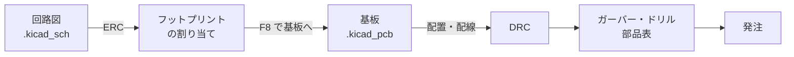

# 第2部 KiCad 入門

KiCad で「回路図 → 基板 → 製造データ」まで一通り進めます。最後の章で、H1 の LED 基板を自分で最初から作ります。

| 章 | 内容 |
|---|---|
| [2-1 プロジェクト](2-1-project.md) | プロジェクトの作り方、ライブラリ、Git での管理 |
| [2-2 回路図](2-2-schematic.md) | 部品の配置、配線、ラベル、電源記号、ERC |
| [2-3 フットプリント](2-3-footprint.md) | 割り当て、自作のシンボル・フットプリント |
| [2-4 基板レイアウト](2-4-layout.md) | 外形、配置、配線、ベタ GND、ビア |
| [2-5 デザインルールと DRC](2-5-drc.md) | 発注先のルールに合わせる |
| [2-6 出力](2-6-output.md) | 3D 表示、ガーバー、ドリル、部品表 |
| [2-7 練習：LED 基板](2-7-practice.md) | 最初から最後まで一人で作る |

!!! tip "よく使うキー"
    | 回路図 | | 基板 | |
    |---|---|---|---|
    | ++a++ | 部品（シンボル）を置く | ++x++ | 配線する |
    | ++p++ | 電源記号を置く | ++v++ | 配線中にビアを打って面を変える |
    | ++w++ | 線を引く | ++d++ | 配線を引きずって直す |
    | ++l++ | ラベル | ++r++ | 回転 |
    | ++q++ | 未接続フラグ（×） | ++f++ | 裏面に移す |
    | ++e++ | プロパティ | ++b++ | ベタを塗りなおす |
    | ++r++ / ++x++ / ++y++ | 回転 / 左右反転 / 上下反転 | ++f8++ | 回路図から基板を更新 |
