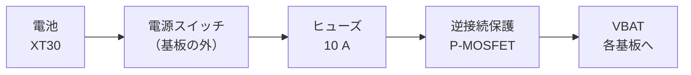

# 3-3 保護：逆接続・ヒューズ・電源スイッチ

## ねらい

- 逆接続保護・ヒューズ・電源スイッチの役割と順番を説明できる
- P チャネル MOSFET による逆接続保護のしくみを説明できる

## 電源の入り口の並び

教材の電源基板は、電池から次の順に通ります。



### 電源スイッチ（非常停止）

ルールで、すぐに電源を切れる手段が必要です（[0-2](../part0-intro/0-2-rules.md)）。

- スイッチは**基板の外**（ロボットの上面など、手が届くところ）に付け、XH 2P（J2）で基板とつなぎます。
- スイッチには**モータの電流が全部流れる**ので、定格電流がピークより大きいものを選びます（例：10 A 以上のトグルスイッチ・ロッカースイッチ）。
- タクトスイッチのような小さいスイッチで、MOSFET を ON/OFF する方法もあります（ソフトスイッチ）。部品は増えますが、大きなスイッチがいりません（もっと深く参照）。

!!! warning "XH 2P とスイッチの電流"
    J2 に使っている XH は 3 A 程度が目安です。モータのピークが 10 A 近くになるなら、スイッチの配線は XT30 にするか、太い線を基板に直接はんだ付けします。教材の基板は「平均 4 A」を想定した練習用の値です。自分のロボットでは [3-2](3-2-current.md) の表で確かめてください。

### ヒューズ

ショートしたときに、配線や電池が燃える前に切れます。

| 種類 | 特徴 |
|---|---|
| 平型ヒューズ（ミニ） | 切れたら交換。安い、手に入りやすい。教材で使用（F1） |
| ポリスイッチ（PTC） | 切れても冷えると戻る。抵抗が大きめで、大電流には不向き |
| ガラス管ヒューズ | ホルダーが大きい |

### 逆接続保護（P チャネル MOSFET）

[1-4](../part1-basics/1-4-diode-led.md) で、ダイオードは電力をむだにすると学びました。電源基板では P チャネル MOSFET（Q1）を使います。

```
VBAT_F（ヒューズの後）── D   S ── VBAT（各基板へ）
                            G
                            ├── 100 kΩ ── GND
                            └── ツェナー 15 V ── S
```

しくみ：

1. **正しくつないだとき**：最初は MOSFET の中のダイオード（ボディダイオード）を通って、S 側に電気が来ます。するとゲート（GND につながっている）がソースより低くなり、MOSFET が ON になります。以後は $R_{DS(on)}$ が小さいので、ほとんど電力をむだにしません。
2. **逆につないだとき**：ボディダイオードの向きが逆なので電流は流れず、ゲートもソースより低くならないので OFF のまま。回路は守られます。

ツェナーダイオード（D1）は、ゲートとソースの間の電圧が MOSFET の上限（±20 V など）をこえないようにします。3S リポ（最大 12.6 V）では本当は必要ありませんが、高い電圧の電池をつないだときの保険です。

!!! tip "MOSFET の選び方"
    $V_{DS}$ 30〜40 V 以上、$I_D$ がピークの 2 倍以上、$R_{DS(on)}$ が $V_{GS} = -10$ V で 10 mΩ 前後のもの。DPAK（TO-252）のような放熱しやすいパッケージにします。

## 手を動かす

=== "KiCad"

    `kicad/power/power.kicad_sch` の「1. 入力と保護」を見て、次を確かめてください。

    1. Q1 のドレインとソースは、どちらが電池側ですか。
    2. ヒューズ F1 は、スイッチの前と後のどちらにありますか。

=== "計算"

    Q1 の $R_{DS(on)} = 15$ mΩ、平均 4 A、ピーク 10 A のとき、それぞれ何 W の熱が出ますか。

    ??? success "答え"
        平均 $4^2 \times 0.015 = 0.24$ W、ピーク 1.5 W（一瞬なら DPAK で耐えられる）

=== "実機"

    電源基板を組み立てたら（[H7](../handson/h7.md)）、安定化電源（電流制限 0.1 A）を**逆向き**につないで、VBAT の出力が 0 V のままか確かめてください。

## チェック問題

1. P チャネル MOSFET の逆接続保護で、正しくつないだとき最初に電流が通る道はどこですか。
2. ポリスイッチをモータの電源に使わない理由は何ですか。

??? success "答え"
    1. MOSFET の中のボディダイオード。
    2. 抵抗が大きめで電圧が下がり、熱も出る。また切れる電流があいまい。

??? example "もっと深く：ソフトスイッチ"
    大電流のスイッチの代わりに、P チャネル MOSFET を「電源スイッチ」として使い、ゲートを小さなスイッチで切りかえる方法があります。さらにマイコンから「自分で電源を切る」こともできます。ただし、**マイコンが固まっても必ず切れる**ことが非常停止の条件です。ソフトだけで切る仕組みにはしないでください。
