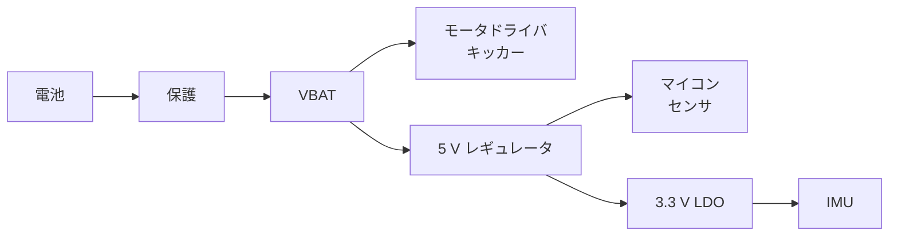

# 3-5 電源の系統を分ける

## ねらい

- モータの電源とロジック（マイコン・センサ）の電源を分ける理由を説明できる
- GND のつなぎ方で、ノイズを小さくする方法を言える

## 理論

### 何が起きるか

モータが回りはじめると、大きな電流が流れて電池の電圧が一瞬下がります。また、モータのブラシや PWM のスイッチングで、速い電圧の変化（ノイズ）が出ます。マイコンと同じ配線を使っていると、

- マイコンの電圧が下がって**リセット**する（ブラウンアウト）
- センサの値にノイズが乗る
- 通信（I2C・UART）がまちがう

ということが起こります。

### 系統の分け方

- **VBAT（電池そのまま）**：モータ・キッカーなど電流の大きいもの
- **+5V・+3V3（レギュレータの後）**：マイコン・センサなど

レギュレータが間にあると、VBAT が一瞬下がっても、5 V はしばらく保たれます（入力・出力のコンデンサもタンクになる）。

### GND のつなぎ方

電流は GND を通って電池に戻ります。モータの大きな電流が、マイコンの GND の配線を通ると、その配線の抵抗で GND の電圧が揺れます。

!!! tip "GND の基本"
    1. **大電流の帰り道は、太く短く、電池の近くで合流させる**（一点でつなぐ考え方）
    2. **基板の中は、ベタ GND で面にする**（[2-4](../part2-kicad/2-4-layout.md)）
    3. **基板どうしをつなぐケーブルには、信号と一緒に GND を通す**（信号の帰り道を作る）

教材では、

- モータドライバ基板には、電源基板から XT30 で VBAT と GND を太く送る
- メイン基板には、XH 4P で 5 V・3.3 V・電池電圧・GND を送る
- メイン基板 → モータドライバ基板の信号ケーブル（XH 5P）にも GND が 1 本入っている

という形にしています。

## 手を動かす

1. `kicad/main/main.kicad_sch` と `kicad/motor/motor.kicad_sch` を開いて、メイン基板とモータドライバ基板の GND が、どのコネクタを通ってつながっているか全部書き出してください。
2. モータの電流（数 A）は、どのコネクタを通って電池に戻りますか。

??? success "答え"
    1. 電源基板 J3（XT30）→ モータ基板 J1、電源基板 J4（XH 4P）→ メイン基板 J1、メイン基板 J3・J4（XH 5P の 5 番）→ モータ基板 J2・J3。
    2. XT30（モータ基板 J1 → 電源基板 J3）。XH の GND は細いので、大電流は流れない設計にします。

## チェック問題

1. マイコンを VBAT から LDO なしで動かせる？ という質問に、どう答えますか（マイコンボードは 7〜12 V の VIN 入力を持つとする）。
2. 信号ケーブルに GND を入れないと、どうなりますか。

??? success "答え"
    1. 動くことは多いが、ボード上の小さな LDO が熱くなり、モータの電圧変動も受けやすい。教材のように 5 V を別に作るほうが安定する。
    2. 信号の帰り道が別のケーブルを大回りすることになり、ノイズを受けやすくなる。
