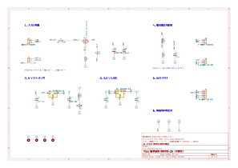
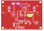

# 3-7 電源基板を設計する

## ねらい

- 教材の電源基板の回路図と基板を読み、各部品の役割を説明できる
- 自分のロボットに合わせて、電源基板を作りかえられる

## 回路図

{ .schem }

| ブロック | 部品 | 役割 | 章 |
|---|---|---|---|
| 1. 入力と保護 | J1（XT30 オス）、J2（スイッチへ）、F1（10 A）、Q1（P-MOSFET）、R1、D1（15 V ツェナー）、C1（470 µF）、C2（0.1 µF） | 逆接続・ショートから守る、電圧を安定させる | [3-3](3-3-protection.md) |
| 2. 5 V | U1（R-78E5.0-1.0）、C3、C4、R4・D2（電源 LED） | 5 V を作る | [3-4](3-4-regulator.md) |
| 3. 3.3 V | U2（AP2112K-3.3）、C5、C6 | 3.3 V を作る | [3-4](3-4-regulator.md) |
| 4. 電池電圧の監視 | R2（100 k）、R3（33 k）、C7 | 電池電圧をマイコンへ | [3-6](3-6-monitor.md) |
| 5. 出力 | J3（XT30 メス：モータへ）、J4（XH 4P：メインへ）、J5（XH 2P：キッカーへ） | 各基板へ配る | [3-5](3-5-domains.md) |
| 6. 測定点 | TP1〜TP3 | 検査用 | [3-6](3-6-monitor.md) |

J4（メイン基板へ）のピンの順番は、1 +5V、2 VBAT_SENSE、3 +3V3、4 GND です。メイン基板の J1 と同じ順にして、ケーブルをまっすぐ（1 番どうし）つなぎます。

## 基板

{ .board width="560" }

{ .board width="560" }

読み取ってほしいこと：

1. **電池の幹線は 2 mm**。J1 → J2（スイッチ）→ F1 → Q1 → C1・J3 と、太く短く。
2. **裏は全面 GND**。表の空いたところも GND で塗りつぶしています。
3. **表面実装の GND のパッドの横にビア**。裏の GND につなぐため。
4. **信号が交差するところは裏を通す**。電池電圧（VBAT_SENSE）と 3.3 V は、一部を裏で配線しています。
5. **コネクタは基板の端**。XT30 の差しこみ口は基板の外を向いています。

## 自分のロボットに合わせる

| 変えたいこと | 直すところ |
|---|---|
| 2S リポにしたい | U1 を入力範囲の合う DC-DC にする。R2・R3 を [1-2](../part1-basics/1-2-divider.md) で計算しなおす |
| ニッケル水素にしたい | 同上。電圧の下限が違うので、低電圧で止める値も変える |
| 5 V の電流が足りない | 2〜3 A の DC-DC にする（[3-4](3-4-regulator.md) もっと深く） |
| ドリブラー用の出力がほしい | J5 と同じように XH 2P か XT30 を足す |
| 基板を小さくしたい | THT の C1 を小さい電解コンデンサ（表面実装）に、XT30 を 1 つにする、など |

## 手を動かす

1. KiCad で `kicad/power/power.kicad_pro` を開き、回路図と基板を見くらべてください（回路図で部品をクリックすると、基板でもその部品が選ばれます：クロスプローブ）。
2. [ハンズオン H2・H3](../handson/h2.md) で、電源基板を自分で設計してみてください。
