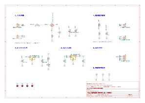

# 第3部 電源

ロボットのトラブルのかなりの部分は電源から来ます。「マイコンが急にリセットする」「モータを回すとセンサの値がおかしくなる」「基板が焦げた」——どれも電源の設計で防げます。

この部では、教材の **電源基板**（3S リポ想定）を題材に、電池から各基板へ電気を配る回路を作ります。

{ .schem }

| 章 | 内容 |
|---|---|
| [3-1 電池の選び方](3-1-battery.md) | リポ・リフェ・ニッケル水素、セル数、放電レート |
| [3-2 消費電流の見積もり](3-2-current.md) | 合計とピークを表にする |
| [3-3 保護](3-3-protection.md) | 逆接続、ヒューズ、電源スイッチと非常停止 |
| [3-4 電圧を下げる](3-4-regulator.md) | LDO とスイッチング、発熱の計算 |
| [3-5 電源の系統を分ける](3-5-domains.md) | モータ用とロジック用、GND のつなぎ方 |
| [3-6 電池電圧の監視](3-6-monitor.md) | 分圧、低電圧での停止、検査用の測定点 |
| [3-7 電源基板を設計する](3-7-power-board.md) | 教材の電源基板を読み解く |
