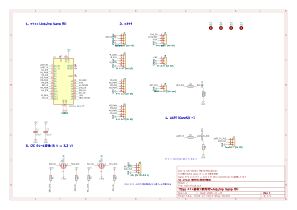
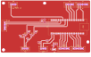
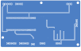

# 4-6 メイン基板を設計する

## ねらい

- マイコンのピンの割り当てを、配線の都合も考えて決められる
- 教材のメイン基板の回路図と基板を読める

## ピンの割り当て

ピンは、まず**機能で決まっているもの**から割り当てます。

1. 決まっているもの：UART（D0・D1）、SPI（D11 MOSI・D12 MISO・D13 SCK）、I2C（A4 SDA・A5 SCL）、PWM が出るピン（D3・D5・D6・D9・D10・D11）、アナログ専用（A6・A7）
2. そのうえで、**基板の上で配線が交差しないように**残りを決める

教材のメイン基板の割り当て：

| Nano のピン | 信号 | つなぐ先 | 決めた理由 |
|---|---|---|---|
| D0（RX） | UART_RX | J7（CoreS3） | UART |
| D1（TX） | UART_TX → 分圧 → UART_TX_3V3 | J7（CoreS3） | UART、3.3 V に変換 |
| D2 | M1_DIR | J3-1 | 下の列、J3 の並びに合わせる |
| D3 | M1_PWM | J3-2 | PWM |
| D4 | M2_DIR | J3-3 | |
| D5 | M2_PWM | J3-4 | PWM |
| D6 | M3_PWM | J4-1 | PWM |
| D7 | M3_DIR | J4-2 | |
| D8 | REF_IN | J9（審判モジュール） | 残った下の列のピン |
| D9 | M4_PWM | J4-3 | PWM |
| D10 | M4_DIR | J4-4 | SPI を使うとき D10 は出力にする必要があるので、出力の信号にした |
| D11 | （未使用） | — | SPI の MOSI。74HC165 は読むだけなので使わない |
| D12 | IR_DATA | J2-4 | SPI の MISO |
| D13 | IR_CLK | J2-2 | SPI の SCK |
| A0 | IR_LOAD | J2-1 | 上の列、J2 の近く |
| A1 | KICK | J5-3 | 上の列、J5 の近く |
| A2 | HV_SENSE | J5-2 | アナログ |
| A3 | CHG_EN | J5-1 | |
| A4 | SDA_5V → レベル変換 | J6（IMU） | I2C |
| A5 | SCL_5V → レベル変換 | J6（IMU） | I2C |
| A6 | LINE | J8（ラインセンサ） | アナログ専用 |
| A7 | VBAT_SENSE | J1（電源基板） | アナログ専用 |

!!! note "ピンが足りない"
    Arduino Nano のピンは、ほぼ全部使いきりました。ラインセンサは 1 本しか読めず、スタートボタンも付けられません。これが、強いチームがサブマイコンを使ったり、ピンの多いマイコンを使ったりする理由です（[8-1](../part8-system/8-1-split.md)）。

## コネクタのピン表

| コネクタ | 1 | 2 | 3 | 4 | 5 | 相手 |
|---|---|---|---|---|---|---|
| J1 電源（XH 4P） | +5V | VBAT_SENSE | +3V3 | GND | | 電源基板 J4 |
| J2 IR リング（XH 5P） | IR_LOAD | IR_CLK | +5V | IR_DATA | GND | IR リング基板 J1 |
| J3 モータ 1・2（XH 5P） | M1_DIR | M1_PWM | M2_DIR | M2_PWM | GND | モータ基板 J2 |
| J4 モータ 3・4（XH 5P） | M3_PWM | M3_DIR | M4_PWM | M4_DIR | GND | モータ基板 J3 |
| J5 キッカー（XH 4P） | CHG_EN | HV_SENSE | KICK | GND | | キッカー基板 J2 |
| J6 IMU（PH 4P） | +3V3 | SCL_3V3 | SDA_3V3 | GND | | IMU モジュール |
| J7 CoreS3（XH 3P） | UART_TX_3V3 | UART_RX | GND | | | CoreS3 |
| J8 ライン（XH 3P） | LINE | +5V | GND | | | ラインセンサ |
| J9 審判（ピンヘッダ 1×2） | REF_PIN | GND | | | | 審判モジュール |

## 回路図と基板

{ .schem }

{ .board width="640" }

{ .board width="640" }

読み取ってほしいこと：

1. **上の列（A0〜A7、D13）の信号は上のコネクタへ、下の列（D0〜D12）の信号は下のコネクタへ**。交差が少なくなります。
2. **左へ行く束（+5V・電池電圧・I2C）は、Nano の 2 列の間を通って左へ**。
3. **交差するところは裏で**：IR_DATA（D12）は下の列なのに上の J2 へ行くので、裏を通して右の端を回っています。+3V3 と、5 V のプルアップへの電源も裏です。
4. **Nano の USB は右の端**。組み立てても書きこめます。

## 手を動かす

1. `kicad/main/main.kicad_pcb` を開き、裏（B.Cu）だけを表示して、裏を通っている信号を全部書き出してください。
2. [ハンズオン H4](../handson/h4.md) で、ピンの割り当てを変えたメイン基板を設計してみてください。
