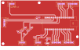

# 第4部 マイコン周り

マイコンは、センサの値を読み、モータやキッカーに命令を出す「頭」です。この部では、マイコンをほかの基板とつなぐ **メイン基板** を作ります。

{ .board width="600" }

| 章 | 内容 |
|---|---|
| [4-1 ボードを載せるか、チップを載せるか](4-1-module.md) | 開発ボード・モジュール・チップ直接のちがい |
| [4-2 3.3 V と 5 V](4-2-level.md) | レベル変換（分圧・MOSFET） |
| [4-3 リセット・ブート・書き込み](4-3-boot.md) | 書き込みの方法とつまずき |
| [4-4 コネクタの選び方](4-4-connector.md) | XH・PH・GH・ピンヘッダ、抜け対策 |
| [4-5 デバッグ用の端子・審判モジュール](4-5-debug.md) | LED、スイッチ、審判モジュールの GPIO |
| [4-6 メイン基板を設計する](4-6-main-board.md) | ピンの割り当てと配置 |
