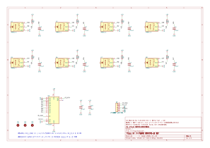
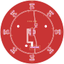

# 5-3 IR リング基板の設計

## ねらい

- 円形の基板に、センサを等間隔に並べる方法を説明できる
- 教材の IR リング基板を読み、プログラムで読み出せる

## 教材の IR リング基板

- 直径 90 mm の円形、受光モジュール 8 個（45° ごと）
- 各モジュールに 100 Ω と 0.1 µF の電源フィルタ
- 74HC165 で 8 個をまとめ、メイン基板へ SPI と同じ 3 本の線で送る

{ .schem }

{ .board width="480" }

{ .board width="480" }

## 円形の基板の作り方

### 外形

`Edge.Cuts` に「円」ツールで描きます。中心の座標をきりのよい値（例：(47.5, 47.5) mm）にしておくと、あとの計算が楽です。

### 等間隔に並べる

センサ $k$（$k = 0, 1, \dots, 7$）の位置は、正面を 0° として時計回りに

$$
\theta_k = 45^\circ \times k,\quad
x_k = c_x + r\sin\theta_k,\quad
y_k = c_y - r\cos\theta_k
$$

（KiCad の y は下向きが正なので、上が −）。半径 $r = 39$ mm なら、センサ 0 は $(47.5,\ 8.5)$ です。

部品をダブルクリックして、位置（X・Y）と向き（回転角）を数字で入れます。数が多いときは、KiCad の Python スクリプト（「ツール → スクリプトコンソール」）で並べる方法もあります。

!!! tip "向きにも注意"
    受光モジュールの「受ける面（ドーム）」が外を向くように回転させます。フットプリントのシルク（半円の印）でドームの向きがわかります。

### 配線

- **表（F.Cu）**：+5V をリング状に回し、各モジュールの R・C へ配る
- **裏（B.Cu）**：各モジュールの出力を、中心の 74HC165 へまっすぐ（放射状に）引く
- 表と裏の残りは GND のベタ

放射状の配線と、リング状の電源が交差しても、表と裏に分けているのでぶつかりません。

## センサと入力の対応

基板の上で配線が交差しないように、センサの番号と 74HC165 の入力の番号を決めました（[8-2](../part8-system/8-2-bus.md) の考え方）。

| センサ（向き） | 0（0°） | 1（45°） | 2（90°） | 3（135°） | 4（180°） | 5（225°） | 6（270°） | 7（315°） |
|---|---|---|---|---|---|---|---|---|
| 74HC165 の入力 | D3 | D2 | D1 | D0 | D7 | D6 | D5 | D4 |

SPI で 1 バイト読むと、最初（最上位ビット）に D7 が来るので、読んだ値の **ビット $b$ が D$b$** になります。

## 読み出しのプログラム（Arduino）

```cpp
#include <SPI.h>

const int PIN_LOAD = A0;                       // IR_LOAD（メイン基板の割り当て）
const uint8_t SENSOR_TO_D[8] = {3, 2, 1, 0, 7, 6, 5, 4};

uint8_t readRing() {
  digitalWrite(PIN_LOAD, LOW);                 // 8 個を同時に取りこむ
  delayMicroseconds(1);
  digitalWrite(PIN_LOAD, HIGH);
  SPI.beginTransaction(SPISettings(4000000, MSBFIRST, SPI_MODE0));
  uint8_t b = SPI.transfer(0);                 // D7 → D0 の順に 8 ビット
  SPI.endTransaction();
  return b;
}

void setup() {
  Serial.begin(115200);
  pinMode(PIN_LOAD, OUTPUT);
  digitalWrite(PIN_LOAD, HIGH);
  SPI.begin();
}

void loop() {
  // 2500 µs の間に何回も読んで、L（受光）だった回数を数える
  uint16_t count[8] = {0};
  uint16_t n = 0;
  uint32_t t0 = micros();
  while (micros() - t0 < 2500) {
    uint8_t b = readRing();
    for (int k = 0; k < 8; k++) {
      if (((b >> SENSOR_TO_D[k]) & 1) == 0) count[k]++;   // L = 受光
    }
    n++;
  }
  for (int k = 0; k < 8; k++) {
    Serial.print(count[k] * 100 / n);          // 受光時間の割合（%）
    Serial.print(k < 7 ? ',' : '\n');
  }
}
```

!!! tip "うまく読めないとき"
    - 全部 255（受光なし）のまま：IR_LOAD・IR_CLK のつなぎまちがい、74HC165 の電源。
    - 値がずれる：SPI のモードを `SPI_MODE0` と `SPI_MODE1` で試す。速さを 1 MHz に下げる。
    - それでもだめなら、`shiftIn(12, 13, MSBFIRST)` で 1 ビットずつ読んで比べる。

## 16 個にするには

74HC165 をもう 1 個足し、1 個目の Q7 を 2 個目の DS につなぎます（デイジーチェーン）。SPI で 2 バイト読めば 16 個分です。基板は直径 100 mm くらいにすると、配線に余裕が出ます。

## チェック問題

1. センサ 6（270°、左）の値は、読んだバイトのどのビットですか。
2. 表に +5V のリング、裏に放射状の出力、としたのはなぜですか。

??? success "答え"
    1. D5 なのでビット 5。
    2. リングと放射状の線はどうしても交差するので、表と裏に分けて、ビアなしでぶつからないようにするため。
