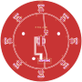

# 第5部 センサ

サッカーロボットのセンサの回路を作ります。中心は、ボールの赤外線を受ける **IR リング基板** です。

{ .board width="420" }

| 章 | 内容 |
|---|---|
| [5-1 IR 受光モジュールの回路](5-1-ir-receiver.md) | 電源のフィルタ、出力の扱い |
| [5-2 たくさんのセンサを読む](5-2-many-inputs.md) | 直接・マルチプレクサ・シフトレジスタ・サブマイコン |
| [5-3 IR リング基板の設計](5-3-ir-ring.md) | 円形の外形、等間隔の配置、読み出しのプログラム |
| [5-4 ラインセンサ](5-4-line.md) | 可視光の LED とフォトトランジスタ、遮光 |
| [5-5 ボール保持センサ](5-5-ball-hold.md) | IR を出さずに作る方法 |
| [5-6 IMU](5-6-imu.md) | I2C、プルアップ、取り付け位置 |
| [5-7 カメラやサブ基板](5-7-camera.md) | CoreS3 とのつなぎ方 |

!!! note "機械学習の教材とのつながり"
    IR リングの値の読み方（受光時間の割合を測る）と、その値からボールの角度・距離を推定する方法は、[RCJ サッカーで機械学習 第1部](https://asg1223.github.io/rcj-soccer-ml/) でくわしく扱っています。
