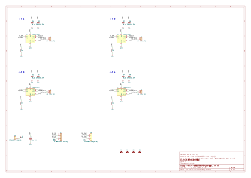

# 6-5 モータドライバ基板を設計する

## ねらい

- 教材のモータドライバ基板の回路と配置を説明できる
- IN1 = 向き、IN2 = PWM のつなぎ方で、モータを両方向に回すプログラムを書ける

## 回路図

{ .schem }

モータ 1 個あたりの部品：

| 部品 | 値 | 役割 |
|---|---|---|
| U（DRV8871DDA） | — | H ブリッジ |
| R（ILIM） | 32 kΩ | 電流の上限 約 2 A |
| C | 0.1 µF 50 V | VM のパスコン |
| C | 10 µF 25 V | VM の小さなタンク |
| J（XH 2P） | — | モータへ |

基板の入り口に 470 µF 25 V（C9）があります。

## コネクタのピン表

| コネクタ | 1 | 2 | 3 | 4 | 5 | 相手 |
|---|---|---|---|---|---|---|
| J1 電源（XT30 オス） | GND（−） | VBAT（＋） | | | | 電源基板 J3 |
| J2 信号（XH 5P） | M1_DIR | M1_PWM | M2_DIR | M2_PWM | GND | メイン基板 J3 |
| J3 信号（XH 5P） | M3_PWM | M3_DIR | M4_PWM | M4_DIR | GND | メイン基板 J4 |
| J4〜J7 モータ（XH 2P） | OUTx1 | OUTx2 | | | | モータ 1〜4 |

J3 は 180° 回して付けています。基板の上では、左から **M1・M2・M4・M3** の順に並びます（配線が交差しないようにするため）。

## 基板

{ .board width="640" }

{ .board width="640" }

読み取ってほしいこと：

1. **VBAT の幹線（2.5 mm）を下に通し**、各ドライバの VM へ 0.8 mm で上がる。
2. **ドライバは 270° 回して、入力が上・出力と VM が下**。信号は上から、電力は下から入る。
3. **モータのコネクタはドライバのすぐ右**。出力の配線（0.8 mm）が短い。
4. **放熱パッドの下にサーマルビア**。裏の GND ベタに熱を逃がす。
5. **信号は上側だけ**を通り、電力の配線とまざらない。

## プログラム：IN1 = 向き、IN2 = PWM

マイコンの PWM のピンを節約するため、IN1 には向き（ふつうの出力）、IN2 には PWM をつないでいます。[6-2](6-2-h-bridge.md) の表から、

| 向き（IN1） | IN2 が H | IN2 が L | 速さを決めるもの |
|---|---|---|---|
| 0 | 逆転 | 空転 | IN2 の H の割合 |
| 1 | ブレーキ | 正転 | IN2 の **L** の割合 |

なので、向きが 1 のときは PWM を反転して出します。

```cpp
// speed: -255〜255
void setMotor(int pinDir, int pinPwm, int speed) {
  speed = constrain(speed, -255, 255);
  if (speed >= 0) {
    digitalWrite(pinDir, LOW);
    analogWrite(pinPwm, speed);          // IN1=0, IN2=PWM
  } else {
    digitalWrite(pinDir, HIGH);
    analogWrite(pinPwm, 255 + speed);    // IN1=1, IN2 を反転（-speed が大きいほど L が長い）
  }
}

// メイン基板の割り当て（4-6）
setMotor(2, 3, 100);    // M1
setMotor(4, 5, 100);    // M2
setMotor(7, 6, 100);    // M3
setMotor(10, 9, 100);   // M4
```

!!! note "回る向き"
    「正」がどちら向きかは、モータのつなぎ方で変わります。実際に回して、ロボットが前に進む向きを確かめ、プログラムで符号を合わせます。

## 手を動かす

1. KiCad で `kicad/motor/motor.kicad_pcb` を開き、U1 の放熱パッドの下のビアを数えてください。
2. [ハンズオン H6](../handson/h6.md) で、モータドライバ基板を設計します。

## チェック問題

1. IN1 = 1 のとき、`analogWrite(pin, 0)` にするとモータはどうなりますか。
2. 470 µF を基板の入り口に置くのはなぜですか。

??? success "答え"
    1. IN2 がずっと L なので、IN1=1・IN2=0 → 正転の全速。反転を忘れると逆の動きになる。
    2. 4 個のモータが同時に起動したときの大きな電流の変化を、電池やケーブルの代わりに一瞬まかなって、電圧の落ちこみを小さくするため。
