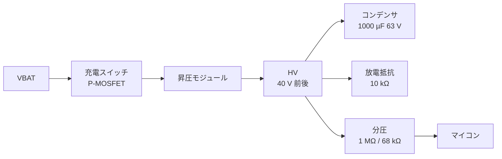

# 7-2 昇圧とコンデンサの充電

## ねらい

- 電池の電圧を上げてコンデンサを充電する回路の形を説明できる
- 48 V をこえないための設計を挙げられる

## 理論

### 昇圧の方法

| 方法 | 特徴 |
|---|---|
| **昇圧モジュール**（DC-DC ブースト） | 出力電圧を半固定抵抗で調整できるものが多い。教材で使う |
| コンデンサ充電専用 IC（フライバック） | 速く充電できる、充電完了を知らせる。設計がむずかしい（もっと深く） |

教材のキッカー基板では、市販の昇圧モジュールを XH 4P（J3）でつなぎます。



### 充電のオン・オフ

Q1（P チャネル MOSFET）で、昇圧モジュールへの電源を切りかえます（[1-5](../part1-basics/1-5-mosfet.md) のハイサイドスイッチ）。

- 蹴る瞬間は充電を止める（昇圧モジュールの電流が、放電の大電流とまざらないように）
- 試合が止まっているときは充電しない（電池の節約・安全）

### 48 V をこえないために

1. **昇圧モジュールの出力を 40 V 前後に調整**してから、基板につなぐ（テスターで確かめる）。
2. **マイコンで HV を測る**：1 MΩ と 68 kΩ で分圧して ADC へ。48 V のとき約 3.06 V。上限に近づいたら充電を止める。
3. **部品の耐圧**：コンデンサは 63 V 品、MOSFET は 100 V 品、ダイオードは 200 V 品と余裕をもたせる。

```cpp
float readHV() {
  int raw = analogRead(A2);                  // HV_SENSE
  float v = raw * 5.0 / 1023.0;
  return v * (1000.0 + 68.0) / 68.0;         // 1 MΩ と 68 kΩ
}

void chargeControl() {
  float hv = readHV();
  if (hv > 42.0) digitalWrite(A3, LOW);      // CHG_EN：充電を止める
  else if (hv < 38.0) digitalWrite(A3, HIGH);
}
```

!!! warning "分圧の抵抗の耐圧"
    1 MΩ の抵抗には HV のほとんど（約 45 V）がかかります。小さいチップ抵抗には「かけてよい電圧」の上限（0603 で 50〜75 V など）があるので、教材では 1206 を使っています。

### 充電時間

昇圧モジュールの出力の電力 $P$、効率 $\eta$ とすると、

$$
t \approx \frac{\frac{1}{2}CV^2}{P\,\eta}
$$

1000 µF・40 V（0.8 J）を、10 W・効率 80 % で充電すると、約 0.1 秒（実際は、はじめの電流制限などでもっとかかります）。[計算ツール](../tools/index.md#cap)で確かめられます。

## チェック問題

1. HV が 45 V のとき、HV_SENSE は何 V ですか。
2. 蹴るときに充電を止める理由は何ですか。

??? success "答え"
    1. $45 \times 68/1068 \approx 2.87$ V
    2. 放電の大電流と昇圧の電流がまざって、電池の電圧が大きく下がったり、昇圧モジュールに負担がかかったりしないようにするため。

??? example "もっと深く：コンデンサ充電専用 IC"
    LT3750 のようなフライバック方式のコンデンサ充電 IC を使うと、トランスで効率よく高電圧を作り、目標電圧で自動的に止まり、「充電完了」の信号も出せます。トランスの選び方、高電圧の配線の間隔、スナバ回路など設計の要素が多いので、データシートとアプリケーションノートの回路と基板をそのまままねるところから始めます。
