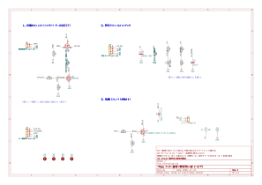
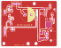

# 7-5 キッカー基板を設計する

## ねらい

- 教材のキッカー基板の回路と基板を読み、高電圧の配線の注意を説明できる
- ルールの試験に合わせて、蹴る強さを調整できる

## 回路図

{ .schem }

| ブロック | 部品 | 章 |
|---|---|---|
| 1. 充電のオン・オフ | Q1（P-MOSFET）、Q2（BSS138）、R1〜R4 | [1-5](../part1-basics/1-5-mosfet.md)、[7-2](7-2-boost.md) |
| 2. 昇圧とコンデンサ | J3（昇圧モジュールへ）、C1（1000 µF 63 V）、R5（放電）、R8・D1（表示）、R6・R7・C2（監視） | [7-2](7-2-boost.md)、[7-4](7-4-safety.md) |
| 3. 放電 | Q3（N-MOSFET 100 V）、D2（ES3D）、R9・R10、J4（ソレノイドへ） | [7-3](7-3-discharge.md) |

## コネクタのピン表

| コネクタ | 1 | 2 | 3 | 4 | 相手 |
|---|---|---|---|---|---|
| J1（XH 2P） | VBAT | GND | | | 電源基板 J5 |
| J2（XH 4P） | CHG_EN | HV_SENSE | KICK | GND | メイン基板 J5 |
| J3（XH 4P） | VIN_SW（モジュールの入力＋） | GND | HV（モジュールの出力＋） | GND | 昇圧モジュール |
| J4（XT30 メス） | SOL_N（−） | HV（＋） | | | ソレノイド |

## 基板

{ .board width="560" }

高電圧の配線の注意：

1. **HV と SOL_N は 1.5 mm の太さ、ほかの配線との間隔 0.6 mm**（ネットクラス HV）。教材では、ベタ GND との間隔も 0.6 mm にしています。
2. **大電流のループを小さく**：C1（＋）→ ソレノイド → Q3 → GND → C1（−）の道を短く。
3. **KICK の信号は裏面を通して** HV の配線をまたいでいます。表と裏で直角に交わるようにします。
4. **シルクに「HIGH VOLTAGE」**。

!!! note "間隔 0.6 mm の根拠"
    IPC-2221 では、コーティングしていない外側の配線で 50 V までなら 0.6 mm の間隔が目安とされています。48 V はこの範囲に入ります。

## 強さの調整とルールの試験

ルールでは、キッカーの強さはフィールドでの試験で確かめます（自分のゴールの壁の前から蹴ったボールが、はね返って自分のゴール側の壁に当たらないこと、など。その年のルールを確かめてください）。

調整できるもの：

| 調整 | 方法 |
|---|---|
| 充電の電圧 | 昇圧モジュールの出力、プログラムの止める電圧 |
| パルスの長さ | `kick(ms)` の ms |
| 機構 | ソレノイドとボールの距離、プランジャの重さ |

!!! tip "試験用のモードを作っておく"
    「弱く蹴るモード」をプログラムに用意し、ボタンやスイッチで切りかえられるようにしておくと、車検で慌てません。

## 手を動かす

1. KiCad で `kicad/kicker/kicker.kicad_pro` を開き、「ファイル → 基板設定 → ネットクラス」で HV のクラスの設定を確かめてください。
2. [ハンズオン](../handson/index.md) の H6 の発展課題で、キッカー基板を設計してみてください。
