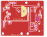

# 第7部 キッカー

ソレノイドでボールを蹴る **キッカー基板** を作ります。この部は**高い電圧（最大 48 V）**をあつかいます。[7-4 安全](7-4-safety.md) を先に読んでから進めてください。

{ .board width="520" }

| 章 | 内容 |
|---|---|
| [7-1 ソレノイドのしくみ](7-1-solenoid.md) | なぜ電圧を上げるのか |
| [7-2 昇圧とコンデンサの充電](7-2-boost.md) | 48 V 以下を守る設計 |
| [7-3 放電の回路](7-3-discharge.md) | MOSFET、フライバックダイオード |
| [7-4 安全](7-4-safety.md) | 放電抵抗、測定点のカバー、作業前の確認 |
| [7-5 キッカー基板を設計する](7-5-kicker-board.md) | 教材の基板、強さの調整 |

!!! danger "高電圧の注意"
    - コンデンサには、電源を切っても電気が残ります。**触る前に必ずテスターで 0 V を確かめる。**
    - 端子どうしをドライバーなどでショートさせて放電しない（火花で部品や工具がこわれる、やけどする）。抵抗を通して放電する。
    - 一人で作業しない。先生や経験のある人と一緒に。
