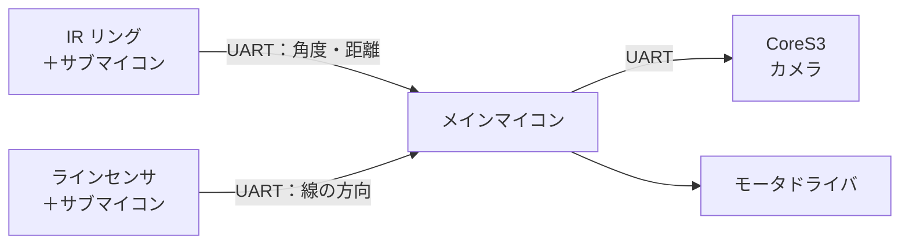

# 8-1 1 枚にするか分けるか

## ねらい

- 基板を分けるよい点・悪い点を比べて、自分のロボットの構成を決められる

## 比べる

| | 1 枚にまとめる | 分ける（教材） |
|---|---|---|
| 配線・コネクタ | 少ない、抜けない | 多い、抜けるリスク |
| 大きさ・重さ | 小さく軽くできる | コネクタとケーブルのぶん重い |
| 修理 | 1 か所壊れたら全部作りなおし | 壊れた基板だけ交換 |
| ノイズ | 配置の工夫が必要 | 大電流と信号を物理的に離せる |
| 設計の手間 | 1 回で大きく、むずかしい | 1 枚ずつ小さく、少しずつ確かめられる |
| 形 | ロボットの形に合わせにくい | 円形・小さい基板を好きな場所に |

**はじめての基板づくりは、分ける**のがおすすめです。1 枚ずつ作って動かしながら経験をためて、2 台目以降でまとめていくとよいでしょう。

## サブマイコンという考え方

メイン基板のピンが足りないこと（[4-6](../part4-mcu/4-6-main-board.md)）は、サブマイコンで解決できます。

- センサを読む・計算するのはサブマイコン、メインは「どう動くか」を決めるだけ
- メインとサブの間は、UART など 2〜3 本の線
- 機械学習の教材の「2 台構成」（[第5部](https://asg1223.github.io/rcj-soccer-ml/)）も同じ考え方

## チェック問題

1. 初めて基板を作るとき、分けるのがおすすめな理由を 2 つ挙げてください。
2. サブマイコンを使うよい点は何ですか。

??? success "答え"
    1. 1 枚ずつ作って確かめられる、壊れたところだけ交換できる、大電流と信号を離せる（このうち 2 つ）。
    2. メインのピンと計算の負担が減る。基板どうしの配線が少なくなる。
