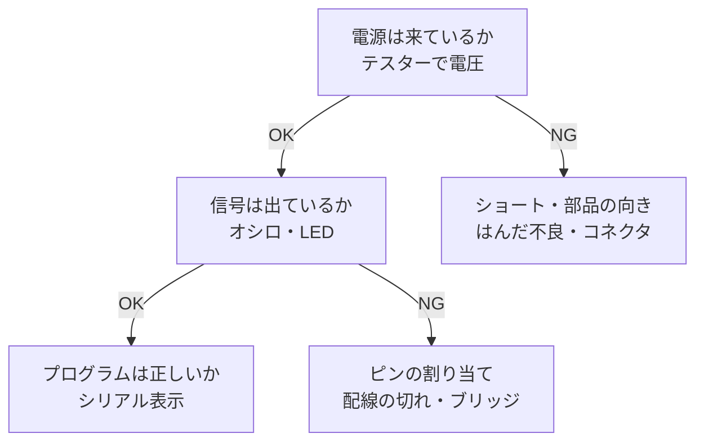

# 9-4 動かないときの調べ方

## ねらい

- 「どこまでは正しく動いているか」を順に確かめて、原因を絞りこめる

## 考え方：電源 → 信号 → プログラム

## よくある症状

| 症状 | 疑うところ |
|---|---|
| マイコンが動いたり止まったりする | 5 V が下がっている（モータを回したときに測る）、GND の配線 |
| モータを回すとリセットする | 電源の系統、バルクコンデンサ、電池の残り（[3-5](../part3-power/3-5-domains.md)） |
| IR リングの値が全部同じ | LOAD・CLK の配線、74HC165 の電源、SPI の設定（[5-3](../part5-sensors/5-3-ir-ring.md)） |
| I2C の機器が見つからない | プルアップ、SDA と SCL の逆、電圧（3.3 V と 5 V）、アドレス |
| モータが片方向にしか回らない | DIR の配線、プログラムの PWM の反転（[6-5](../part6-motors/6-5-motor-board.md)） |
| モータドライバが熱い・止まる | 電流制限、放熱パッドのはんだ |
| キッカーが充電されない | CHG_EN、Q1・Q2、昇圧モジュールの入力 |

## オシロスコープで見るとよいもの

- PWM の波形（周波数・デューティ比）
- SPI の CLK と DATA（74HC165 から値が出ているか）
- 電源の電圧（モータが動いたときの落ちこみ）
- UART の信号の電圧（3.3 V に下がっているか）

!!! tip "記録を残す"
    直したことは、チームのリポジトリの `records/` に書いておきます（日付・症状・原因・直し方）。次の基板の設計に生かせます。

## チェック問題

1. 動かないとき、最初に確かめるのは何ですか。
2. I2C の機器が見つからないとき、確かめることを 3 つ挙げてください。

??? success "答え"
    1. 電源（必要な電圧が来ているか）。
    2. プルアップ、SDA と SCL の逆、電圧、アドレス、GND（このうち 3 つ）。
